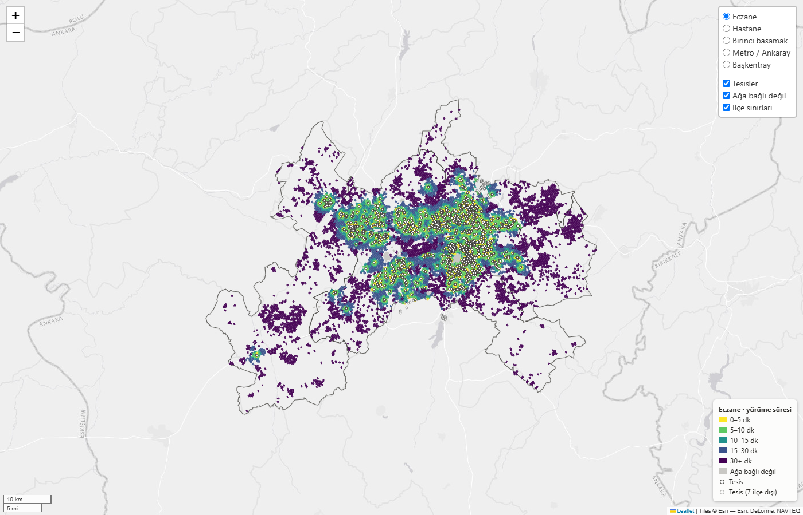

# Ankara Erişilebilirlik Haritası

**Ankara'nın 7 merkez ilçesinde nüfusun %88,8'i en yakın eczaneye 15 dakikada yürüyebiliyor; metro veya Ankaray istasyonuna 15 dakikada yürüyebilenler ise yalnızca %21,1.**

"15 dakikalık şehir" (15-minute city), günlük ihtiyaçların çoğunun evden 15 dakikalık
yürüme ya da bisiklet mesafesinde karşılanmasını hedefleyen bir kentsel planlama
kavramıdır. Bu proje, Ankara'nın merkez ilçelerinde (Çankaya, Keçiören, Yenimahalle,
Mamak, Etimesgut, Sincan, Altındağ) yürüme ağındaki her noktadan en yakın eczane,
birinci basamak sağlık kuruluşu, hastane, metro/Ankaray ve Başkentray istasyonuna
yürüme süresini hesaplar. Sonuçları WorldPop nüfusuyla ağırlıklandırır ve H3
altıgenleriyle haritalar.

**Etkileşimli harita:** <https://samettns.github.io/ankara-erisilebilirlik/> (`docs/index.html`)



## Bulgular

Nüfus ağırlıklı sonuçlar, 7 ilçe toplamı. Oranlar, süresi hesaplanabilen nüfusa
göredir: 4.890.778 kişi, toplam nüfusun %97,75'i (bkz. [Veri boşlukları](#veri-boşlukları)).

| Hedef | Nüfus ağırlıklı medyan | 15 dk içinde (oran) | 15 dk içinde (kişi) |
|---|---:|---:|---:|
| Eczane | 5,2 dk | %88,8 | 4.340.633 |
| Birinci basamak (ASM, sağlık ocağı, klinik) | 11,1 dk | %66,9 | 3.271.612 |
| Hastane | 17,1 dk | %42,8 | 2.092.924 |
| Metro / Ankaray istasyonu | 35,2 dk | %21,1 | 1.033.404 |
| Başkentray istasyonu | 59,4 dk | %9,8 | 480.096 |

İlçe bazında 15 dk içinde ulaşabilen nüfus oranı (parantez içinde nüfus ağırlıklı medyan, dk):

| İlçe | Nüfus (WorldPop) | Eczane | Birinci basamak | Hastane | Metro / Ankaray | Başkentray |
|---|---:|---:|---:|---:|---:|---:|
| Çankaya | 965.150 | %93,8 (4,2) | %65,0 (11,5) | %59,9 (12,8) | %24,0 (37,7) | %5,2 (77,4) |
| Keçiören | 964.282 | %97,0 (4,2) | %86,8 (8,8) | %54,9 (13,6) | %29,6 (24,1) | %0,0 (84,8) |
| Yenimahalle | 736.811 | %86,8 (5,6) | %56,0 (13,6) | %32,8 (21,0) | %35,8 (20,0) | %4,1 (61,6) |
| Mamak | 704.753 | %88,0 (5,2) | %75,2 (10,5) | %36,9 (19,7) | %3,2 (57,2) | %21,7 (25,4) |
| Etimesgut | 619.703 | %79,6 (7,1) | %53,4 (13,6) | %27,5 (24,9) | %13,2 (56,9) | %19,2 (33,1) |
| Sincan | 587.958 | %76,0 (6,8) | %57,8 (11,9) | %40,3 (17,6) | %13,6 (45,9) | %17,4 (39,1) |
| Altındağ | 424.676 | %93,3 (5,8) | %62,2 (12,9) | %29,4 (20,9) | %20,8 (42,4) | %9,5 (53,9) |

- Eczane her ilçede yakın: en zayıf ilçe Sincan'da bile nüfusun dörtte üçü 15 dakika içinde.
- Raylı sistem en büyük açık. Mamak'ta metro/Ankaray'a 15 dakikada yürüyebilen nüfus
  %3,2. Mamak'ın Başkentray'a erişimi (%21,7) ise metro/Ankaray'dan daha iyi.
- Hastane erişimi ilçeler arasında en çok değişen kategori: Çankaya'da %59,9,
  Etimesgut'ta %27,5.

Sonuçlar OSM'de haritalanmış tesislere dayanır (eksik ya da kapanmış tesis
sonucu etkiler). Analiz tarihi Kasım 2026, OSM verisi 2026-11-05.

## Yöntem

1. **Yürüme ağı:** Geofabrik Türkiye PBF'inden Ankara kesiti alınır. 7 ilçenin 2 km
   genişletilmiş birleşik alanı için OSMnx `walk` ağı tek parça kurulur ve sadeleştirilir.
   Sınırdakiler komşu ilçedeki tesislere de ulaşabilir. Analiz en büyük bağlı parçada
   yapılır: 124.633 düğüm.
2. **Hedefler (OSM):** 1.603 eczane, 195 birinci basamak kuruluşu ve 100 hastane.
   Hastanelere kampüs sınırı boyunca her 50 m'de bir nokta konur, toplam 950 nokta.
   Bunlara 54 metro/Ankaray istasyonu (187 giriş) ve 24 Başkentray istasyonu eklenir.
   Tekrarlayan kayıtlar mesafe ve isim benzerliğiyle birleştirilir.
3. **Mesafe:** Her hedef noktası en yakın ağ düğümüne bağlanır (eşik 200 m). Grafa
   sanal bir süper kaynak eklenir, bu kaynaktan her bağlanan düğüme ağırlığı
   bağlantı mesafesi olan bir kenar çekilir. Böylece kategori başına tek bir
   `networkx.dijkstra_predecessor_and_distance` çalıştırması her düğüm için en yakın
   tesise olan mesafeyi verir. En yakın tesis, öncül zinciri izlenerek bulunur.
   Yürüme hızı 80 m/dk.
4. **Konut siteleri (son kilometre):** Konut alanındaki `access=private` yollar ikinci
   bir aşamada kullanılır. Site sakinleri bu yollardan çıkabilir ama site dışındakiler
   siteyi kestirme olarak kullanamaz.
5. **Altıgenler:** Düğüm süreleri H3 çözünürlük 9 altıgenlerinde medyanla özetlenir.
6. **Nüfus:** WorldPop 2025, 100 m, sınırlandırılmış (constrained) raster. Nüfus
   ağırlıklı medyan ve 15 dk dışında kalan kişi sayısı ilçe ve kategori bazında hesaplanır.

Ayrıntılar, bilinen sınırlamalar ve yöntem kararları: [`docs/notlar.md`](docs/notlar.md).

## Doğrulama

- **Kaba kuvvet:** Süper kaynaklı sonuç, tesis noktası başına ayrı Dijkstra ile
  karşılaştırıldı (2.956 Dijkstra). Karşılaştırma gerçek ağda rastgele seçilen 350
  düğümde yapıldı, 58'i site içi. Beş kategoride de 350/350 düğümde süre ve en yakın
  tesis aynı çıktı. En büyük fark 5,7·10⁻¹⁴ dk (`python -m src.dogrulama`).
- **Sadeleştirme:** Sadeleştirilmiş ağdaki 124.633 düğümün tamamında, beş kategoride
  de süreler sadeleştirilmemiş ağla aynı çıkıyor (en büyük fark 1·10⁻¹² dk).
- **Nüfus (TÜİK sağlaması):** WorldPop'un 7 ilçe toplamı 5.003.333 kişi. TÜİK ADNKS
  2025'e göre 4.951.676 kişi, fark +%1,04. İlçe bazında fark −%2,9 (Sincan) ile
  +%3,5 (Keçiören) arasında.

## Veri boşlukları

- **Ağa bağlı olmayan altıgenler:** 94 altıgen (87'si nüfuslu), 26.521 kişi, nüfusun
  %0,5'i. Çoğu askerî alan ya da kampüs gibi halka kapalı yerleşkelerde. Bu
  altıgenler haritada gri.
- **Düğümsüz altıgenler:** İçinde yürüme ağı düğümü olmayan 5.087 nüfuslu altıgen,
  toplam 86.033 kişi, nüfusun %1,7'si. Bu nüfusun %80,7'si bağlı bir altıgenin
  bitişiğinde; büyük kısmı geometrik bir etki.

## Çalıştırma

Python 3.11+ gerekir.

```bash
pip install -r requirements.txt

python -m src.veri_cek     # OSM PBF indir (~620 MB, bir kez), ağ ve hedefler (tepe bellek ~2,3 GB)
python -m src.mesafe       # düğüm başına yürüme süreleri
python -m src.altigen      # H3 altıgen özetleri
python -m src.nufus        # WorldPop nüfusu (~74 MB, bir kez), nüfus ağırlıklı sonuçlar
python -m src.harita       # data/sonuclar/harita.html ve docs/index.html

python -m src.dogrulama    # isteğe bağlı: kaba kuvvet doğrulaması (~20 dk)
python -m src.karsilastir ONCEKI_DIZIN SONRAKI_DIZIN   # iki sonuç klasörünü karşılaştır
```

İndirilen ve üretilen tüm veriler `data/` altına yazılır (git'e girmez) ve diske
önbelleklenir. Girdisinden yeni olan bir çıktı tekrar üretilmez. Kullanılan veri
sürümleri ve sağlama değerleri [`veri_surumu.json`](veri_surumu.json) dosyasında.

## Testler

```bash
python -m pytest
```

195 test, `tests/` altında (tamamı geçiyor).

## Veri kaynakları ve lisans

- Yol ağı, tesisler ve ilçe sınırları: © [OpenStreetMap katkıcıları](https://www.openstreetmap.org/copyright),
  [ODbL 1.0](https://opendatacommons.org/licenses/odbl/). Geofabrik `turkey-latest.osm.pbf`, 2026-11-05.
- Nüfus: [WorldPop](https://www.worldpop.org/) Global2 R2025A v1, 2025, 100 m
  (doi:10.5258/SOTON/WP00839), [CC BY 4.0](https://creativecommons.org/licenses/by/4.0/).
  WorldPop bu sürümü alfa olarak tanımlıyor.
- İlçe nüfusu sağlaması: TÜİK ADNKS 2025.
- Altlık harita: Esri World Light Gray Canvas.

Kod [MIT lisansı](LICENSE) ile yayımlanmıştır.
